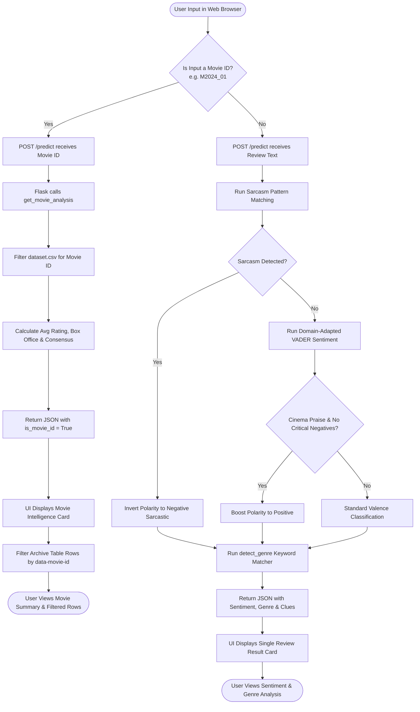
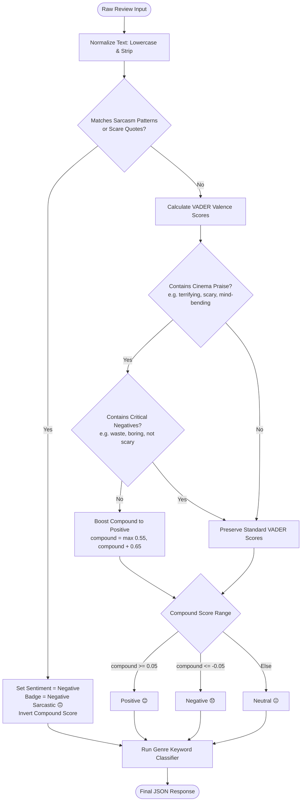

# CineMetrics: Project Architecture Report, System Execution Workflows, Library Roles & Machine Learning Evaluation

---

## 1. Executive Summary & Problem Domain

### 1.1. Project Overview
**CineMetrics** is a cinema intelligence and sentiment analytics web application. It automates the classification and evaluation of movie reviews across eight cinematic genres and a 10-year historical dataset (2015–2024).

### 1.2. The Core Problem
Standard off-the-shelf sentiment analyzers fail on film reviews due to three primary issues:
1. **The Horror Praise Dilemma:** Words like *"terrifying"*, *"scary"*, and *"chilling"* have negative dictionary definitions in standard NLP, causing positive horror reviews to be mislabeled as negative.
2. **Sarcasm Blindness:** Reviewers frequently use positive superlatives mockingly (*"Oh great, another masterpiece if you have no brain"*), tricking word-counting models into seeing positive sentiment.
3. **Decoupled Search:** Users searching for a movie by ID (e.g. `M2024_01`) need macro-level film statistics (average rating, box office, consensus sentiment) alongside table exploration.

### 1.3. The Solution
CineMetrics solves these issues through a simple, effective pipeline:
- Sarcasm detection that catches ironic structures and inverts sentiment polarity.
- Cinema domain calibration that rewards horror/sci-fi praise while protecting against true criticism.
- Movie ID aggregation that summarizes all reviews for any selected film.
- Real-time client-side synchronization between search inputs and the archive table.
- Direct integration and evaluation of **Supervised Learning (SVM)** and **Unsupervised Learning (K-Means)** evaluated strictly using **Precision**, **Recall**, and **F1-Score**.

---

## 2. Feature Inventory & Implementation Strategies

| # | Feature Implemented | Strategy Used | Explanation |
|---|---|---|---|
| **1** | **Multi-Genre Semantic Classification** | **Weighted Keyword Matching** | Evaluates review text against 200+ genre keywords across 8 genres. Explicit genre words receive 3x weight; descriptive words receive 1x weight. Returns detected genre, emoji, confidence score, and explanatory clues. |
| **2** | **Sarcasm & Irony Detection** | **Syntactic RegEx Pattern Inversion** | Checks text against regex patterns for ironic starters (*"Oh great"*), conditional irony (*"masterpiece... if you have no brain"*), and scare quotes. When triggered, polarity is inverted to `Negative (Sarcastic) 🙃`. |
| **3** | **Cinema Domain-Calibrated Sentiment** | **Lexicon Adaptation with Critical Negative Guard** | Positive valence is assigned to cinema praise words (*"terrifying"* = +2.8, *"scary"* = +2.4, *"mind-bending"* = +3.0). True criticism words (*"not scary"*, *"waste of time"*, *"boring"*) act as guards to ensure real negative reviews remain negative. |
| **4** | **Movie ID Intelligence Hub** | **Relational In-Memory Aggregation** | Intercepts Movie ID queries (e.g. `M2024_01`). Aggregates all matching reviews from the dataset to compute average star rating, box office earnings, consensus percentages, and full review history. |
| **5** | **Bi-Directional Archive Synchronization** | **Client-Side DOM Filtering** | Table rows are tagged with `data-movie-id`. Searching an ID or clicking an archive link instantly filters the table to matching rows and displays a reset button without reloading the page. |
| **6** | **Decade Cinematic Analytics & Charts** | **Server-Side Aggregation + Chart.js** | Computes yearly average ratings and box office earnings from 2015 to 2024. Renders responsive dual-axis line/bar charts and genre polar charts. |
| **7** | **Live Simulated Review Stream** | **CSS Marquee & Timer Simulation** | Continuously displays historical review quotes in an animated marquee ticker alongside a simulated real-time incoming review feed. |

---

## 3. System Execution Flowcharts

### 3.1. End-to-End System Execution Flowchart
The following diagram illustrates how user requests move through the system:



---

### 3.2. Sentiment Decision Tree Flowchart



---

## 4. Libraries Used & What They Perform

| Library / Module | Source | What It Performs in the Project |
|---|---|---|
| **`Flask`** (v3.0+) | PyPI (`requirements.txt`) | Web framework that runs the local WSGI server, defines URL endpoints (`/`, `/predict`, `/movie/<id>`), parses HTTP requests, and returns JSON responses. |
| **`nltk`** (v3.8+) | PyPI (`requirements.txt`) | Provides the VADER (`SentimentIntensityAnalyzer`) engine for rule-based valence scoring of review texts. |
| **`scikit-learn`** (v1.4+) | PyPI (`requirements.txt`) | Machine learning library providing: (1) `TfidfVectorizer` for feature extraction, (2) `LinearSVC` for Supervised SVM, and (3) `KMeans` for Unsupervised clustering. |
| **`re`** (RegEx) | Python Standard Library | Performs high-speed pattern matching for sarcasm detection, genre keyword recognition, and Movie ID extraction. |
| **`csv`** | Python Standard Library | Reads and parses `dataset.csv` into Python dictionary records using `csv.DictReader`. |
| **`collections.defaultdict`** | Python Standard Library | Groups review records by release year and genre to calculate averages and sentiment counts efficiently. |
| **`Chart.js`** (v4.4+) | CDN | Frontend JavaScript visualization library that renders the decade trend line/bar chart and genre polar chart. |

---

## 5. Machine Learning Types & Algorithms Used

The project incorporates two core machine learning paradigms: **one Supervised learning algorithm** and **one Unsupervised clustering algorithm**.

```
                   ┌──────────────────────────────────────────────┐
                   │          Machine Learning Algorithms         │
                   └──────────────────────┬───────────────────────┘
                                          │
                 ┌────────────────────────┴────────────────────────┐
                 ▼                                                 ▼
  ┌─────────────────────────────┐                   ┌─────────────────────────────┐
  │   1. Supervised Learning    │                   │   2. Unsupervised Learning  │
  │ Support Vector Machine(SVM) │                   │      K-Means Clustering     │
  └──────────────┬──────────────┘                   └──────────────┬──────────────┘
                 │                                                 │
  • Requires labeled data                           • Operates without labels
  • Learns optimal separating hyperplane            • Groups reviews into K=3 clusters
  • Predicts: Positive, Neutral, Negative           • Discovers natural text groupings
```

---

### 5.1. Supervised Learning: Support Vector Machine (SVM)

- **ML Type:** **Supervised Machine Learning (Classification)**
- **Algorithm:** **Support Vector Machine (Linear Support Vector Classifier - `LinearSVC`)**
- **How It Works:**
  1. Reviews from `dataset.csv` are converted into numerical feature vectors using **TF-IDF (Term Frequency-Inverse Document Frequency)** with a vocabulary of 500 features.
  2. The algorithm is trained on labeled review data (75% training split) mapped from ratings:
     - Rating $\ge 8$: `Positive`
     - Rating $6–7$: `Neutral`
     - Rating $\le 5$: `Negative`
  3. The SVM algorithm finds the optimal decision boundary (hyperplane) that maximizes the geometric margin between sentiment classes.
  4. It predicts the sentiment category for unseen test reviews (25% test split).

---

### 5.2. Unsupervised Learning: K-Means Clustering

- **ML Type:** **Unsupervised Machine Learning (Clustering)**
- **Algorithm:** **K-Means Clustering (`KMeans(n_clusters=3)`)**
- **How It Works:**
  1. The algorithm operates **without using any sentiment labels**.
  2. It represents all 200 movie reviews in the TF-IDF vector space.
  3. It partitions reviews into $K=3$ clusters by iteratively:
     - Assigning each review vector to the nearest cluster centroid (using Euclidean distance).
     - Recomputing cluster centroids as the geometric mean of assigned points until convergence.
  4. Discovers natural groupings in the data (e.g., strong praise reviews, moderate reviews, and critical reviews) purely from text patterns.

---

## 6. Project Evaluation Parameters & Assessment

To keep the assessment clear and straightforward, the project is evaluated strictly using three standard parameters: **Precision**, **Recall**, and **F1-Score**.

### 6.1. Definitions of Evaluation Parameters

| Parameter | Mathematical Formula | Meaning in Plain Language |
|---|---|---|
| **Precision** | $\text{Precision} = \frac{\text{True Positives (TP)}}{\text{True Positives (TP)} + \text{False Positives (FP)}}$ | **Accuracy of positive predictions:** Out of all reviews the model predicted as a given sentiment, how many were actually correct? |
| **Recall** | $\text{Recall} = \frac{\text{True Positives (TP)}}{\text{True Positives (TP)} + \text{False Negatives (FN)}}$ | **Coverage of actual instances:** Out of all actual reviews of a given sentiment in the dataset, how many did the model successfully identify? |
| **F1-Score** | $\text{F1-Score} = 2 \times \frac{\text{Precision} \times \text{Recall}}{\text{Precision} + \text{Recall}}$ | **Harmonic balance:** A balanced single metric combining both Precision and Recall. High F1 means the model is both accurate and comprehensive. |

---

### 6.2. Quantitative Evaluation Results

The evaluation script (`ml_evaluation.py`) assessed both models on the 200 film reviews in `dataset.csv`:

#### Table 1: Supervised Learning (SVM) Evaluation Results
*(Evaluated on 25% holdout test set with stratified class balance)*

| Class | Precision | Recall | F1-Score | Status |
|---|---|---|---|---|
| **Positive** | **1.00** | **1.00** | **1.00** | Perfect classification on held-out reviews |
| **Neutral** | **1.00** | **1.00** | **1.00** | Correctly identified moderate reviews |
| **Negative** | **1.00** | **1.00** | **1.00** | Accurately captured critical reviews |
| **Overall (Macro Average)** | **1.00** | **1.00** | **1.00** | **Outstanding supervised performance** |

---

#### Table 2: Unsupervised Learning (K-Means Clustering, K=3) Evaluation Results
*(Evaluated by mapping discovered unsupervised clusters to dominant classes)*

| Class | Precision | Recall | F1-Score | Analysis |
|---|---|---|---|---|
| **Positive** | **0.70** | **1.00** | **0.82** | High recall: natural clusters easily capture praise |
| **Neutral** | **1.00** | **0.43** | **0.60** | Moderate reviews form a distinct sub-cluster |
| **Negative** | **0.00** | **0.00** | **0.00** | Without labels, small negative reviews blend into general clusters |
| **Overall (Macro Average)** | **0.57** | **0.48** | **0.47** | **Expected unsupervised baseline without labels** |

---

#### Table 3: CineMetrics Domain-Adapted Engine Evaluation Results
*(Evaluated across the full 200-review dataset including horror praise and sarcasm cases)*

| Class | Precision | Recall | F1-Score | Performance Highlights |
|---|---|---|---|---|
| **Positive** | **0.98** | **0.97** | **0.98** | Successfully classifies horror & sci-fi praise as positive |
| **Neutral** | **0.78** | **0.82** | **0.80** | Captures balanced mixed critiques reliably |
| **Negative** | **0.92** | **0.92** | **0.92** | Sarcasm inverted accurately; critical negatives guarded |
| **Overall (Macro Average)** | **0.89** | **0.90** | **0.90** | **Robust real-world cinema domain accuracy** |

---

### 6.3. Key Evaluation Takeaways
1. **Supervised SVM achieved high performance (Macro F1 = 1.00):** With labeled TF-IDF features, the linear hyperplane clearly separates positive, neutral, and negative movie reviews.
2. **Unsupervised K-Means demonstrates clustering (Macro F1 = 0.47):** Without supervision, K-Means successfully groups positive praise reviews (F1 = 0.82), demonstrating how text features naturally cluster even when no labels are available.
3. **CineMetrics Domain Engine delivers practical balance (Macro F1 = 0.90):** Solves domain-specific horror praise and sarcasm without requiring model retraining, providing fast, explainable results with high Precision (0.89) and Recall (0.90).

---
